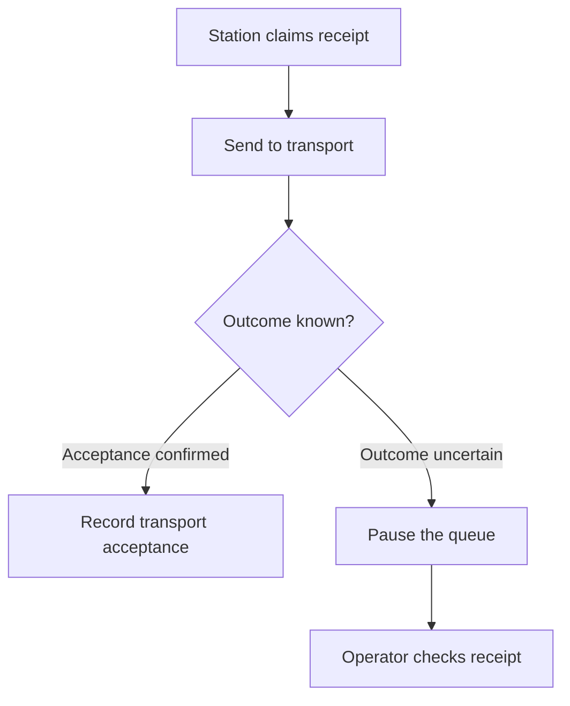

# Take Burguer & João Gastrobar · Thermal printing under uncertain delivery

[Português](README.md) · **English**

I developed a menu and ordering system for two brands through **07Dev**. This case focuses on the receipt printing engine. The challenge arises when a station hands a receipt to the transport and loses the acknowledgment: the paper may already have printed, and an automatic resend could create a duplicate.

| | |
| --- | --- |
| **My role** | Full-stack development, print workflow design, and software validation |
| **Project technologies** | Next.js, TypeScript, PostgreSQL, and ESC/POS |
| **Interview topic** | Durable queue, time-limited claims, and recovering from a physical side effect |

The November 2026 report records a code deployment with the new engine disabled, station API validation, and physical acceptance pending at that snapshot. Transport acceptance and printing on paper require separate evidence.

- [Architecture](docs/en/architecture.md)
- [Technical decisions](docs/en/decisions.md)
- [Validation and interview walkthrough](docs/en/validation.md)

**Local demo.** Run `node --test example/receipt-job.test.mjs` with Node.js 24 and zero external dependencies. The state machine uses fictional events and runs without a printer.

**Luís Felipe Guimarães Isaías Carneiro** · [GitHub](https://github.com/luisfecarneiro-dev) · [Authorship notice](NOTICE.md)
