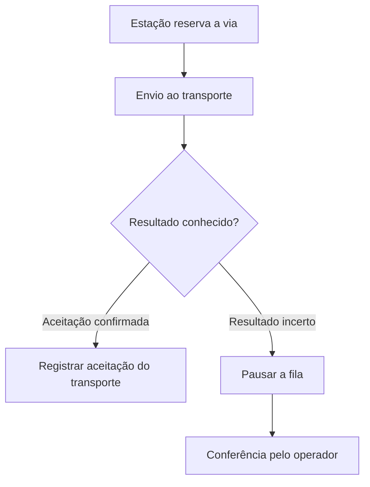

# Take Burguer & João Gastrobar · Impressão térmica com confirmação incerta

**Português** · [English](README.en.md)

Desenvolvi pela **07Dev** um sistema de cardápio e pedidos para duas marcas. Este caso detalha o motor de impressão de comprovantes. O desafio aparece quando a estação envia uma via ao transporte e perde a confirmação: o papel pode ter saído, e reenviar automaticamente pode gerar uma segunda via.

| | |
| --- | --- |
| **Meu papel** | Desenvolvimento full stack, desenho do fluxo de impressão e validação de software |
| **Tecnologias do projeto** | Next.js, TypeScript, PostgreSQL e ESC/POS |
| **Tema para entrevista** | Fila persistente, reserva com prazo e recuperação de uma ação com efeito físico |

O relatório de novembro de 2026 registra publicação do código com a ativação do motor desligada, validação da API de estação e homologação física pendente naquele recorte. A aceitação pelo transporte e a impressão em papel exigem evidências próprias.

- [Arquitetura](docs/pt-br/architecture.md)
- [Decisões técnicas](docs/pt-br/decisions.md)
- [Validação e roteiro de entrevista](docs/pt-br/validation.md)

**Demonstração local.** `node --test example/receipt-job.test.mjs`, com Node.js 24 e zero dependências externas. A máquina de estados usa eventos fictícios e pode ser executada sem impressora.

**Luís Felipe Guimarães Isaías Carneiro** · [GitHub](https://github.com/luisfecarneiro-dev) · [Aviso de autoria](NOTICE.md)
