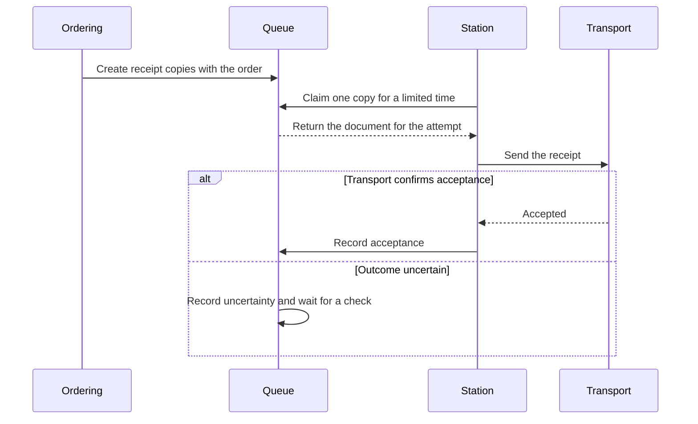

# Architecture

[Português](../pt-br/architecture.md) · [English](../../README.en.md)

Creating an order stages receipt copies in the same transaction. The active station claims one copy for a limited time. The server prepares a thermal document for the attempt. The station checks the document, sends it to the transport, and records the outcome it knows. The queue retains state so the station can resume work through a defined decision.

## States that matter

Sending has physical effects. A claim that expires before any send can be recovered safely if the system can establish that condition. When the lease expires after dispatch begins, the documented rule marks the outcome uncertain. A transport acknowledgment means that layer accepted the receipt. The operator or an acceptance mechanism needs to verify the paper.

The [local simulation](../../example/receipt-job.mjs) isolates a single job. It shows attempt matching, the acknowledgment window, and state transitions. The product also has to coordinate claims, authenticate stations, and scope queues to stores.
