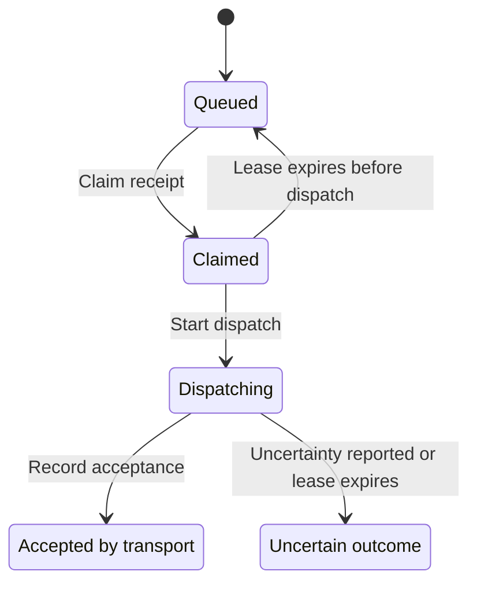

# Technical decisions

[Português](../pt-br/decisions.md) · [English](../../README.en.md)

## Create receipt copies with the order

Recording receipt copies in the same transaction ties the intent to print to order creation. An alternative discussed in this case is triggering printing directly from the browser that placed the order, which ties the operation to the page lifecycle. A durable queue requires consumer coordination and attempt tracking.

## Limit each attempt in time

The station gets a temporary claim. Acknowledgment is bound to the attempt that claimed the work. That rule keeps a stale acknowledgment from completing the current attempt. The dispatch state determines how expiration is handled.

## Make uncertainty explicit

Retrying every communication failure is risky for a physical action. The receipt may already have printed before the interruption. The documented rule pauses the queue and waits for an operator check when the outcome is uncertain. This trades short-term queue availability for an informed decision about reprinting.

Conceptual diagram of the states exercised by the simulation. The operator check happens outside it.

## Confirm at the right layer

A transport can accept a document without proving that readable paper came out. The approach therefore measures the software contract, transport behavior, and physical acceptance separately.
