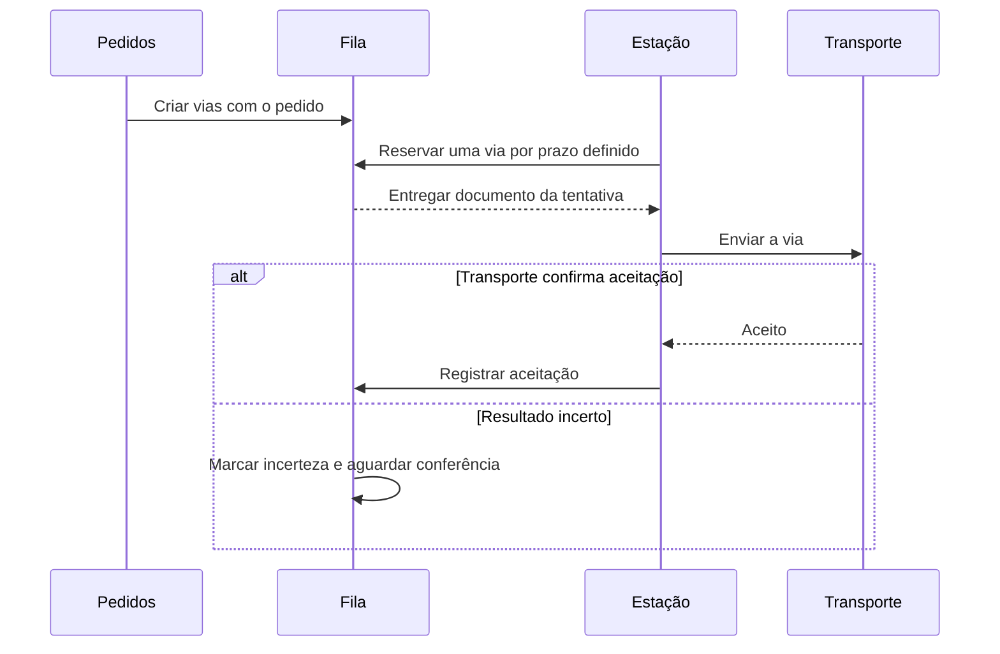

# Arquitetura

[Português](../../README.md) · [English](../en/architecture.md)

Criar o pedido gera as vias dentro da mesma transação. A estação ativa reserva uma via por prazo definido. O servidor prepara um documento térmico para aquela tentativa. A estação verifica o documento, envia ao transporte e registra o resultado conhecido. A fila mantém o estado para que a estação possa recuperar o trabalho com uma decisão definida.

## Estados que importam

O envio tem efeitos físicos. Uma reserva que expira antes de qualquer envio permite recuperar o trabalho com segurança se o sistema consegue confirmar essa condição. Quando o prazo expira depois que o envio começou, a regra documentada marca incerteza. A confirmação da camada de transporte informa que ela aceitou a via. O operador ou um mecanismo de homologação precisa verificar o papel.

A [simulação local](../../example/receipt-job.mjs) isola um job. Ela mostra correspondência da tentativa, janela de confirmação e transições de estado. O produto também precisa coordenar reservas, autenticar estações e isolar a fila por loja.
