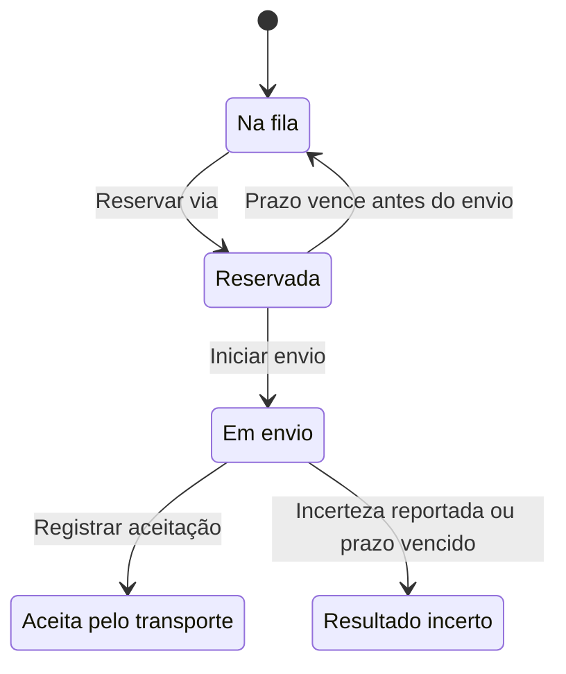

# Decisões técnicas

[Português](../../README.md) · [English](../en/decisions.md)

## Criar vias junto com o pedido

Registrar as vias na mesma transação liga a intenção de imprimir à criação do pedido. A alternativa discutida neste caso é disparar a impressão diretamente no navegador que criou o pedido, o que vincula a operação ao ciclo de vida da página. A fila persistente exige coordenação de consumidores e rastreamento da tentativa.

## Dar prazo à tentativa

A estação recebe uma reserva temporária. A confirmação fica ligada à tentativa que reservou o trabalho. Essa regra evita que uma confirmação de uma tentativa antiga seja usada para finalizar o processamento atual. O estado do envio determina o tratamento dado ao vencimento.

## Dar tratamento explícito à incerteza

A alternativa de repetir qualquer falha de comunicação é perigosa para uma ação física. A impressão pode ter acontecido antes da interrupção. A regra documentada pausa a fila e espera conferência humana quando o resultado fica incerto. Isso troca disponibilidade momentânea da fila por uma decisão informada sobre a reimpressão.

Diagrama conceitual dos estados exercitados na simulação. A conferência do operador ocorre fora dela.

## Confirmar na camada correta

O transporte pode aceitar um documento sem provar a legibilidade ou a saída do papel. Por isso, a abordagem mede separadamente o contrato de software, o comportamento do transporte e o aceite físico.
